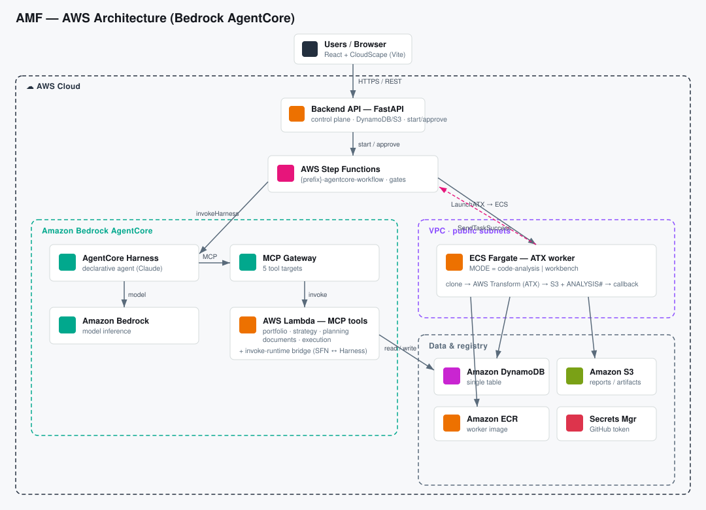

# Sample Agentic Modernization Framework (AMF)

> [!IMPORTANT]
> **Proof of concept: not for production use.** AMF is sample code that shows how an agentic
> workflow (Amazon Bedrock AgentCore, AWS Step Functions and AWS Transform) can drive the
> *planning and engineering steps* of an application modernisation. It is not a supported AWS
> product, migration service or migration factory, and it is not production-ready:
> - Deploy it only into a **dedicated, non-production sandbox AWS account** that you own.
> - Use **synthetic or anonymised data only**. Do not load real customer server inventories,
>   credentials, personal data or other confidential data into it.
> - Every generated change (IaC, CI/CD, code transformation) is committed to a migration branch
>   and **must be reviewed by a qualified engineer** before anything is applied. **AMF deploys
>   nothing by default** (`ENABLE_DEPLOY=false`): the journey ends at a reviewed branch that you
>   apply yourself. With `ENABLE_DEPLOY=true`, a deploy runs only after an Admin approves the exact commit.
> - You are responsible for reviewing, testing and securing any code you deploy, for your own
>   security assessment, and for compliance with the laws and policies that apply to you. See
>   [SECURITY.md](SECURITY.md) and [Security considerations](#security-considerations).

AMF is a proof of concept for on-premises → AWS application modernisation, one application at a
time, from discovery to handover. Reasoning happens in **one Amazon Bedrock AgentCore Harness**, which calls Lambda-backed
**MCP Gateway tools**. **AWS Step Functions** owns the journey and the human approval gates.
Everything correctness-critical runs as deterministic code, not prompt instructions: phase pre-hooks
and post-checks, strategy gating, infrastructure and CI/CD generation, and validation. Long-running
**AWS Transform (ATX)** code analysis and transformation run on **ECS Fargate**.
The stack is FastAPI, React/CloudScape and Terraform.

## Architecture



- **Control plane:** the React UI calls the FastAPI backend (`/api/v1`). The backend reads and
  writes DynamoDB + S3 and starts and approves Step Functions executions.
- **Journey state machine:** `{prefix}-agentcore-workflow` (`infra/step-functions/migration-workflow.v2.asl.json`,
  JSONata, 51 states). Each state type is invoked differently:
  - Agent phases use `invokeHarness`.
  - Pre-hooks, post-checks and approval gates use the `invoke-runtime` Lambda.
  - Infrastructure, CI/CD and validation call the `tool-execution` Lambda directly.
  - ATX and `terraform plan` use `waitForTaskToken`, calling back from the ECS worker.
- **One agent:** the Harness (`{prefix}_harness`). Its system prompt is a base prompt plus 9
  skill playbooks (`backend/resources/skills/*.md`), composed in `harness.tf`.
- **MCP Gateway, 5 Lambda targets:**

  | Target | Tools |
  |---|---|
  | portfolio | get_app_context, update_app_field, search_machines, assign_machines_to_app, get_portfolio_summary, add_owner |
  | strategy | recommend_strategy, calculate_completeness |
  | planning | generate_wave_plan, store_wave_plan, get_wave_plan, store_migration_plan |
  | documents | store_design_document, get_design_document, store_analysis_result, compute_risk_score, get_analysis_result |
  | execution | start_code_analysis, start_code_transformation, get_job_status, provision_infrastructure, generate_cicd, commit_cicd_to_repo |

- **Data:**
  - DynamoDB: one table, `{prefix}_portfolio`. It is read by PK/SK, and listed via `GSI1`
    (`TYPE#<entity>`); it is never scanned.
  - S3: one bucket, `{prefix}-data-{account}-{region}`.

See [docs/architecture.md](docs/architecture.md) for the full flow and data model.

## Features

- **Discovery.** Parses AWS Application Discovery Service (ADS) **export files** that you upload
  (`connectors/adapters/`; no third-party API or SaaS connection) and auto-groups servers
  into applications. Supports L2 enrichment upload and readiness questionnaires. Synthetic sample
  data can be kept locally under `input/` (gitignored).
- **7R strategy + risk score.** The Harness recommends a strategy, and a deterministic risk score
  (0–100) is computed at Discovery. A human confirms or overrides it at `discovery_review`.
  Retire, retain and repurchase go to a close-out handover branch. Rehost and relocate skip
  code transformation.
- **Deterministic guardrails:**
  - Pre-hooks (Discovery, Assessment, Design, Execution) fail fast on missing inputs.
  - Post-checks (Discovery, Assessment, Design, close-out) re-run the phase once with the
    contradictions found, then fail the run.
- **7 approval gates.** Each gate has a decision summary computed in code (what changed, risk,
  consequences of approve, reject and retry). Reviewer comments flow into the re-run, and
  missing fields can be filled in at the gate. Approvals are audited per run (`APPROVAL_AUDIT#`).
- **Execution.** Runs in sequence:
  1. ATX transformation.
  2. DB migration plan.
  3. Terraform generated from the template library, checked against the network-exposure
     policy, then `terraform validate` + `plan`. It is never applied.
  4. CI/CD generated for CodePipeline (CodeCommit source), the only supported CI/CD target.

  Generated IaC and CI/CD are committed to a migration branch in the linked repo.
- **Validation.** A deterministic `validate_deployment` check covers IaC, the CI/CD coverage gate, the transform
  outcome, and live pipeline, ECS and ALB state.
- **Wave planning.** Dependency-aware wave plans. The graph is derived from DynamoDB by default
  (`GRAPH_BACKEND=dynamodb`); Amazon Neptune is optional.
- **Governance.** An approval-audit view (runs and gates per application) built from Step Functions
  history.
- **Chat advisor.** `POST /chat/message` goes to the same Harness, with the transcript kept in S3.

## Prerequisites

| Tool      | Version | For                                   |
|-----------|---------|---------------------------------------|
| Python    | 3.12+   | Backend API + Lambda tests            |
| Terraform | 1.9+    | Infrastructure (everything)           |
| AWS CLI   | 2.x     | Credentials + bootstrap               |
| Docker    | 24+     | Build the worker / API image          |
| Node.js   | 20+ / pnpm 10+ | Frontend (`pnpm-lock.yaml` is the lockfile) |

**AWS access.** You need permissions for DynamoDB, S3, ECS/ECR, Step Functions, Lambda,
Bedrock + Bedrock AgentCore, Secrets Manager, IAM and VPC. `BEDROCK_MODEL_ID` must be an
inference profile that is enabled in your account and region. The AWS provider must be `>= 6.0`
(required by `aws_bedrockagentcore_*`).

## Quick Start

```bash
# Provision everything via Terraform and build/push the worker image.
# All AWS resources are named from the prefix (setup.sh default: amf).
scripts/setup.sh                 # or: scripts/setup.sh myprefix

# Run the backend + frontend locally against the deployed cloud resources
scripts/start.sh                 # uvicorn :8000 + vite :3000   (scripts/stop.sh to stop)
```

**Optional hosted demo** (CloudFront + internal ALB + ECS API + Cognito). Off by default; the
recommended mode is local (`scripts/start.sh`). Only use it in a sandbox account with synthetic data:

```bash
AWS_REGION=us-east-1 ENABLE_PUBLIC_HOSTING=true ADMIN_EMAIL=you@example.com \
  PORTAL_DOMAIN_NAME=amf.example.com \
  PORTAL_ACM_CERTIFICATE_ARN=arn:aws:acm:us-east-1:111122223333:certificate/… \
  CLOUDFRONT_ALLOWED_CIDRS=203.0.113.10/32 \
  scripts/setup.sh demo
```

- The portal is served on **your domain** with an ACM certificate (us-east-1) and a
  **TLSv1.2_2021** minimum. The default `*.cloudfront.net` certificate isn't allowed because it
  permits TLSv1. Point the domain's DNS at the `portal_cloudfront_domain_name` output.
- The API's load balancer is **internal** (private subnets, no public address). CloudFront reaches
  it only through a **CloudFront VPC origin**.
- `CLOUDFRONT_ALLOWED_CIDRS` (strongly recommended) is an AWS WAF allowlist at the edge. Cognito is
  always required behind it: every `/api/*` call needs a valid JWT, and the API refuses to start in
  hosted mode with `DEV_AUTH` on or without Cognito.
- A Cognito pool with `Admin`/`Engineer`/`Viewer` groups and a seed admin is created. The temporary
  password is **not** printed. Read it once with
  `terraform output -raw cognito_admin_temp_password` and reset it at first sign-in.
- Pin `AWS_REGION` if your shell exports another region, because `setup.sh` reads it.

`scripts/setup.sh [prefix]` does the following:
1. Checks prerequisites.
2. Creates `.env` and the venv.
3. Bootstraps the TF-state bucket and lock table, the only resources outside Terraform.
4. Runs `terraform apply` and syncs `backend/resources/templates/` to `s3://…/config/templates/`.
5. Builds and pushes the worker image. With hosting enabled, it also redeploys the API service and
   deploys the SPA.
6. Writes the resolved config to `.env`.

## Project Structure

```
├── backend/src/
│   ├── api/v1/          # FastAPI routers (portfolio, workflow, analysis, design, waves, chat,
│   │                    #   governance, graph, iac, skills, system, infrastructure, …)
│   ├── core/            # Pure logic: wave_planner, completeness, cicd, risk_scoring,
│   │                    #   strategy_options, exposure_policy, validation/
│   ├── db/              # DynamoDB single table (keys, accessors, repository), graph_dynamo, neptune
│   ├── worker/          # ECS worker: MODE=code-analysis | workbench | infra
│   ├── auth/            # Cognito JWT + RBAC + DEV_AUTH bypass
│   ├── connectors/      # Discovery ingestion (ADS adapter)
│   └── config.py        # All settings (pydantic-settings) — single source of resource names
├── backend/resources/
│   ├── skills/          # Harness phase playbooks (composed in harness.tf)
│   └── templates/       # Terraform modules + CodePipeline templates
├── frontend/src/        # React + CloudScape SPA
├── docker/              # Dockerfile.worker (worker + API image)
├── infra/
│   ├── environments/agentcore/   # the single Terraform deployment (+ lambda-src/ tool Lambdas)
│   ├── modules/                  # dynamodb · s3 · ecr · ecs · worker-task (worker + API task defs)
│   └── step-functions/           # migration-workflow.v2.asl.json
└── scripts/             # setup.sh, start.sh, stop.sh, cleanup.sh, verify_gateway_auth.sh, e2e_golden.py,
                         # seed_transformation_steps.py
```

## Commands

```bash
backend/.venv/bin/python -m pytest backend/tests -q                 # backend tests
(cd infra/environments/agentcore/lambda-src && ../../../../backend/.venv/bin/python -m pytest -q)  # Lambda tests
backend/.venv/bin/ruff check backend/src backend/tests   # lint
(cd frontend && pnpm install --frozen-lockfile && pnpm exec tsc --noEmit && pnpm test)  # frontend types + tests
terraform fmt -check -recursive infra                               # Terraform format
(cd infra/environments/agentcore && terraform validate)             # Terraform (init needs -backend-config; setup.sh does it)
```

CI (`.gitlab-ci.yml`) runs all of these and **every job is blocking**; see [CI/CD Setup](docs/cicd-setup.md).

## How we work

Describe design changes in the pull request and get them reviewed before merging. Two non-negotiables apply to
every change ([`CLAUDE.md`](CLAUDE.md)):
1. **No hardcoding.** Tunables, names, ARNs, regions, URLs, model IDs, timeouts and thresholds go in config:
   `backend/src/config.py` Settings, Lambda env vars set in `lambdas.tf`, Terraform variables, or
   `GET /system/capabilities` for the UI.
2. **Security and performance first.** A design change isn't ready to merge until its Security review and Performance review
   are filled in against the current code.

## Configuration

All backend settings live in [`backend/src/config.py`](backend/src/config.py) and can be overridden
by environment variables or `.env` (see [`.env.example`](.env.example)). Resource names derive from
`PROJECT_PREFIX`: table, cluster, state machine `{prefix}-agentcore-workflow`, invoke Lambda and log
group. `setup.sh` writes the Terraform outputs to `.env`, including `AGENTCORE_HARNESS_ARN`,
`AGENTCORE_GATEWAY_ID`/`_URL` and `GRAPH_BACKEND=dynamodb`. Business tunables are also Settings
fields, so you can change them without editing code: strategy confidence floor, wave score cutoffs,
approval aging, timeouts, caches, page sizes and caps. `GET /api/v1/system/capabilities`
exposes the region, supported target regions, poll intervals, harness id, model and feature flags to the UI.

- **Tool Lambdas:** each has a `<lambda>_tunables` Terraform object variable in `lambdas.tf`, where every key
  defaults to today's value. Override one key with `-var 'tool_strategy_tunables={STRATEGY_CONFIDENCE_FLOOR="45"}'`.
- **Infrastructure:** sizing, retention, timeouts, `vpc_cidr` and `approval_timeout_seconds` (the 7-day gate
  timeout) are Terraform variables. `project_prefix` is required.
- **CI:** `AWS_ACCOUNT_ID` and `SECURITY_REPORTS_BUCKET` are GitLab CI/CD variables, set in project settings,
  not in the repo.

## AWS Services

| Service              | Usage                                                   |
|----------------------|---------------------------------------------------------|
| Bedrock AgentCore    | Harness (agent reasoning) + MCP Gateway (5 tool targets)|
| Step Functions       | Journey orchestration, approval gates                   |
| Lambda               | 5 MCP tool targets + `invoke-runtime` bridge            |
| ECS Fargate + ECR    | ATX analysis / transformation, terraform plan, hosted API |
| AWS Transform        | Code analysis + transformation (ATX CLI in the worker)  |
| DynamoDB             | Single-table system of record                           |
| S3                   | Reports, design docs, ATX artifacts, templates, chat sessions |
| CloudWatch / X-Ray   | Logs; Transaction Search (`enable_transaction_search`, default on) |
| CloudFront + ALB       | Hosted portal (SPA + `/api/*`)                        |
| Cognito              | Portal auth (Hosted UI + JWT, Admin/Engineer/Viewer) — UAT |

## Scripts

| Script                               | Purpose                                                    |
|--------------------------------------|------------------------------------------------------------|
| `scripts/setup.sh [prefix]`          | Full deploy: bootstrap state, `terraform apply`, image, `.env` |
| `scripts/start.sh [backend\|frontend\|all]` | Run backend (uvicorn) + frontend (vite) locally      |
| `scripts/stop.sh`                    | Stop local services                                        |
| `scripts/cleanup.sh [infra] [--yes]` | Reset data (DynamoDB + S3 + running SFN/ECS); `infra` also runs `terraform destroy`. Destructive |
| `scripts/seed_transformation_steps.py` | Seed `transformation_steps` for an app (Execution transform input) |
| `scripts/verify_gateway_auth.sh [url]` | Unsigned MCP `tools/list` must get 401/403 (checks the Gateway's IAM authorizer) |
| `scripts/e2e_golden.py` | Golden-app end-to-end run; `--target-account` / `GOLDEN_TARGET_ACCOUNT` |

## Documentation

| Document | Description |
|----------|-------------|
| [Architecture](docs/architecture.md) | Workflow, components, data model, S3 layout |
| [Deployment](docs/deployment.md) | setup.sh, Terraform layout and variables, worker image, IAM |
| [API Reference](docs/api-reference.md) | REST endpoints |
| [Troubleshooting](docs/troubleshooting.md) | Common issues |
| [CI/CD Setup](docs/cicd-setup.md) | GitLab CI checks |
| [Cost & Consumption](docs/cost-consumption.md) | Cost model |
| [Solution overview](docs/solution-overview.md) | What AMF is, how it works, FAQ |
| [Test apps (CodeCommit)](docs/test-apps-codecommit.md) | Test repos mapped to 7R, compute, DB and CI/CD targets |

## Security scanning (not included — use Amazon Inspector)

AMF ships **no security scanner**. The CodePipeline buildspecs it generates run the build, the unit tests
and the coverage gate only; there is no SAST, dependency, secret or image scan stage. If you need one, add
Amazon Inspector to your account and pipeline:

- **Images, functions, instances:** turn on Inspector scanning for the deployed resources, e.g.
  `aws inspector2 enable --resource-types ECR LAMBDA LAMBDA_CODE EC2` (ECR enhanced scanning covers the
  images the pipeline pushes).
- **In the pipeline (CI/CD scanning):** in `cicd/buildspec.yml`, generate an SBOM with the Amazon
  Inspector SBOM Generator and scan it with the Inspector Scan API, failing the build on the severities
  you choose:

  ```yaml
  # install phase
  - curl -fsSLo /tmp/sbomgen.zip https://amazon-inspector-sbomgen.s3.amazonaws.com/latest/linux/amd64/inspector-sbomgen.zip
  - unzip -qj /tmp/sbomgen.zip '*/inspector-sbomgen' -d /usr/local/bin && chmod +x /usr/local/bin/inspector-sbomgen
  # build phase (after the tests)
  - inspector-sbomgen directory --path "$BUILD_DIR" -o /tmp/sbom.json
  - aws inspector-scan scan-sbom --sbom file:///tmp/sbom.json --output-format CYCLONE_DX_1_5 > /tmp/findings.json
  # example gate: fail on any critical finding
  - test "$(jq '[.vulnerabilities[]?.ratings[]? | select(.severity == "critical")] | length' /tmp/findings.json)" = 0
  ```

  The CodeBuild role then needs `inspector-scan:ScanSbom`, and the app permissions boundary must allow it.
- **Remediation:** ATX's `AWS/security-issue-fixer` only fixes findings it is given. AMF does not feed it
  any, so it isn't recommended and the workbench skips it.

See the Amazon Inspector User Guide for the current CI/CD integration steps.

## Security considerations

AMF is a proof of concept. Review [SECURITY.md](SECURITY.md) before you deploy it. The main points:

- **Scope.** AMF generates and reviews migration artefacts. It is not a migration service.
  Generated Terraform is applied only after a human approves the exact migration-branch commit
  (`execution_review`), and only into `DEPLOY_ALLOWED_ACCOUNTS` (default: the account AMF runs in).
  The agent cannot deploy: deploy and destroy are never exposed as MCP Gateway tools.
- **IAM.** The deploy role (`deploy.tf`) can create `APP-*` IAM roles in its own account only, and
  only with the `{prefix}-app-permissions-boundary` attached. That boundary limits app roles to
  their own resources (APP-* or AMF-app-tagged DynamoDB tables, `app-*` buckets/repos, `APP-*`
  functions) and denies IAM writes, `sts:AssumeRole`, Organizations and AMF's own data. Review it
  before you use AMF in any account.
- **Authentication.** The hosted demo uses Amazon Cognito (Hosted UI, OAuth code + PKCE). The API
  validates Cognito JWTs (RS256 against the pool's JWKS, issuer, audience/client id, `token_use`,
  expiry) and maps Cognito groups to roles. `DEV_AUTH` is a **local-only** bypass for
  `scripts/start.sh` on a laptop. It defaults to off, and the API and Terraform both refuse it in
  hosted mode.
- **Untrusted input.** Linked repositories are untrusted. Their build tooling runs in a sandbox as an
  unprivileged user without AWS credentials (`worker/sandbox.py`), and git runs through a
  token-isolating wrapper (`worker/gitcmd.py`).
- **Data at rest and in transit.** DynamoDB, ECR, CloudWatch log groups and Lambda environment
  variables are encrypted with a customer-managed KMS key that rotates (`kms.tf`). S3 buckets use
  SSE-KMS/SSE-S3, block public access, and deny non-TLS requests.
- **Not production hardened.** Some items a production system would need are out of scope for
  this PoC. They are listed under *Known gaps* below and in `infra/.checkov.yaml`.

## Known gaps / deferred

- **MCP Gateway auth** is `AWS_IAM` (SigV4, the Harness signs with its runtime role).
  An environment gets it on its next `terraform apply`; `scripts/verify_gateway_auth.sh` checks that anonymous calls are
  denied. Portal auth (Cognito) is available, and the UAT deploy turns it on.
- **Accepted risk:** ATX runs a repo's build inside the AWS-managed CLI with the worker's
  credentials. Every other repo build runs as the unprivileged `builduser`.
- **Secrets Manager hardening**, **dashboards and alarms**, and least-privilege IAM: some IAM is
  deliberately broad (see the `.tf` comments).
- **Day-2 operations are out of scope for this release** (no post-migration signal scanning or
  automatic follow-up runs).
- **Terraform `project_prefix` is required** (no default), so a manual `terraform apply` must pass
  `-var project_prefix=…`; `setup.sh` always does.

## Main Contributors

* [Akash Kumar](https://github.com/ki2a)
* [Sajed Parathanalli](https://github.com/sajed-p)

## Security

See [SECURITY.md](SECURITY.md) and [CONTRIBUTING.md](CONTRIBUTING.md#security-issue-notifications) for more information.

## Third-party software

AMF's dependencies are listed with their licenses in [THIRD-PARTY-LICENSES](THIRD-PARTY-LICENSES)
(regenerate with `python3 scripts/third_party_licenses.py`). The worker image
(`docker/Dockerfile.worker`) **downloads further tools when you build it**; none of them is stored in this
repository, and each comes under its own license or terms:
- **Terraform** (HashiCorp), Business Source License 1.1 (BUSL-1.1)
- **AWS Transform CLI** (`atx`), AWS Service Terms
- AWS CLI v2 (Apache-2.0), Amazon Corretto 21 (GPL-2.0 with the Classpath Exception), Apache Maven
  (Apache-2.0), Node.js (MIT)

Review those terms before you build and use the image.

## License

This library is licensed under the MIT-0 License. See the [LICENSE](LICENSE) file.
